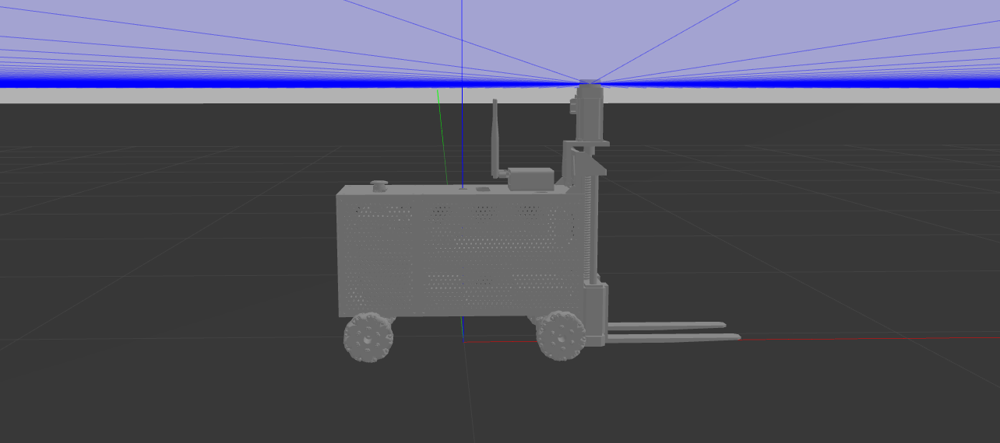

# Forklift Gazebo Simulation

This is a ROS 2 Humble workspace for simulating a custom Mecanum-drive forklift model in Gazebo, featuring omni-directional mobility, optimized physics, and autonomous mapping capabilities.

## Simulation Preview


## Key Features
- **Omni-Directional Movement:** Full 3DOF planar mobility (linear X, linear Y, and angular Z) powered by the `planar_move` plugin.
- **Optimized Physics & Collisions:** Tuned ground friction coefficients (`mu = 0.01`) and adjusted chassis collision boxes to prevent tipping and sliding friction conflicts.
- **LiDAR Integration:** Equipped with a 360-degree LiDAR sensor for environment scanning and mapping.

## Main Packages in the Workspace
- **`forklift_sim`**: The core custom package containing the Mecanum forklift URDF/Xacro models, 3D meshes, LiDAR sensor definitions, and Gazebo launch configurations.
- **`explore_lite`**: Provides autonomous frontier-based exploration algorithms to drive the robot and map unknown environments automatically.
- **`slam_toolbox`**: Handles Simultaneous Localization and Mapping (SLAM) to generate real-time 2D occupancy grid maps using LiDAR scans and robot odometry.
- **`teleop_twist_keyboard`**: Enables manual keyboard teleoperation to test and control multi-directional movement via `/cmd_vel` topics.

---

## Getting Started
First, you must install all required dependencies for the workspace packages using `rosdep`:
```bash
sudo rosdep init # Only run if rosdep is not initialized yet
rosdep update
rosdep install --from-paths src --ignore-src -r -y
```

### 1. Clone the Repository (with Submodules)
If you are cloning this repository for the first time, make sure to initialize submodules:
```bash
git clone --recursive https://github.com/minhthong2514/forklift_gazebo_sim.git
```

### 2. Navigate to your workspace root directory and build using `colcon`
```bash
cd forklift_gazebo_sim
colcon build --symlink-install
```

### 3. Source the environment
```bash
source install/setup.bash
```

### 4. Launch the simulation
```bash
ros2 launch forklift_sim spawn_forklift.launch.py
```

### 5. Control the robot with teleop
You must open a new terminal and run command below:
```bash
source install/setup.bash
ros2 run teleop_twist_keyboard teleop_twist_keyboard
```
